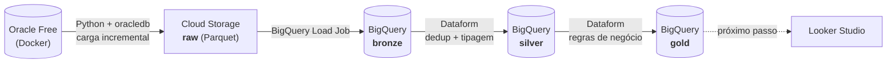
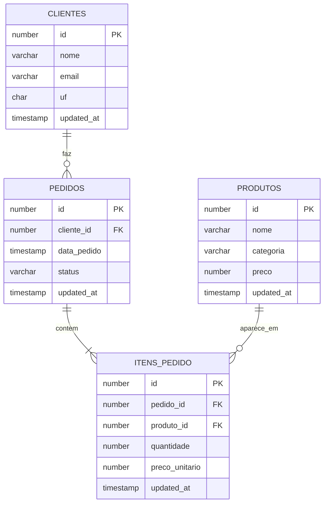

# Pipeline Oracle → BigQuery com Arquitetura Medalhão

Pipeline de dados em lote que leva um banco transacional **Oracle** para um data warehouse no **BigQuery**, organizado em camadas **raw → bronze → silver → gold** e com transformações versionadas e testadas no **Dataform**.

> 🚧 **Status:** em andamento. Veja os [próximos passos](#-próximos-passos).

## 🎯 Problema de negócio

Uma empresa de varejo guarda suas vendas em um Oracle (OLTP). As áreas de negócio precisam de indicadores diários (receita, ticket médio, vendas por categoria) sem pesar o banco de produção e com histórico confiável.

Este projeto mostra como resolver isso:
- **Carga incremental:** extrai só o que mudou, usando `updated_at` como marca d'água.
- **Camadas bem definidas:** dados brutos preservados e regras de negócio isoladas.
- **Qualidade de dados:** assertions no Dataform barram duplicidade, nulos e valores inválidos.
- **Linhagem:** cada linha carrega quando e de onde foi ingerida (`_ingested_at`, `_source`).

## 🏗️ Arquitetura



| Camada | Onde fica | O que contém |
|---|---|---|
| **raw** | `gs://<bucket>/raw/<tabela>/dt=AAAA-MM-DD/` | Arquivos Parquet exatamente como saíram do Oracle |
| **bronze** | dataset `bronze` | Tabelas append-only com todo o histórico de cargas e os metadados de ingestão |
| **silver** | dataset `silver` | Uma linha por registro (versão mais recente), tipos corrigidos e textos padronizados |
| **gold** | dataset `gold` | Tabelas prontas para consumo: vendas diárias e receita por categoria |

## 🧰 Stack

- **Origem:** Oracle Database 23ai Free (imagem `gvenzl/oracle-free` no Docker)
- **Ingestão:** Python 3.11+, `oracledb` (modo thin, sem Instant Client), `pandas`, `pyarrow`
- **Armazenamento:** Google Cloud Storage (raw) e BigQuery (bronze, silver, gold)
- **Transformação e qualidade:** Dataform (SQLX + assertions)

## 📁 Estrutura

```
.
├── docker/
│   ├── docker-compose.yml        # Oracle Free local
│   └── init/                     # Esquema e dados de exemplo
├── ingestion/
│   └── extract_load.py           # Oracle -> GCS (raw) -> BigQuery (bronze)
├── dataform/
│   ├── workflow_settings.yaml
│   └── definitions/
│       ├── sources/bronze.js     # Declaração das tabelas bronze
│       ├── silver/               # Deduplicação, tipagem e assertions
│       └── gold/                 # Indicadores de negócio
├── requirements.txt
└── .env.example
```

## 🗃️ Modelo de dados de origem



## ▶️ Como executar

### Pré-requisitos
- Docker e Docker Compose
- Python 3.11+
- Um projeto no Google Cloud com BigQuery e Cloud Storage ativos, um bucket criado e o [gcloud CLI](https://cloud.google.com/sdk/docs/install) autenticado (`gcloud auth application-default login`)

### 1. Suba o Oracle local
```bash
cp .env.example .env          # ajuste os valores
cd docker && docker compose --env-file ../.env up -d
docker compose logs -f oracle # aguarde "DATABASE IS READY TO USE!"
```

### 2. Rode a ingestão (raw + bronze)
```bash
python -m venv .venv && source .venv/bin/activate   # no Windows: .venv\Scripts\activate
pip install -r requirements.txt
python ingestion/extract_load.py
```
Na primeira execução é feita a carga completa. Nas seguintes, só entram as linhas com `updated_at` maior que o último valor já carregado.

### 3. Rode o Dataform (silver + gold)
- **No console da GCP:** crie um repositório no Dataform ligado a este GitHub, ajuste `defaultProject` em `dataform/workflow_settings.yaml` e execute todas as ações.
- **Ou pela CLI:**
  ```bash
  npm i -g @dataform/cli
  cd dataform && dataform init-creds && dataform run
  ```

### 4. Teste a carga incremental
Altere um registro no Oracle e rode a ingestão de novo:
```sql
UPDATE app.pedidos SET status = 'ENTREGUE', updated_at = SYSTIMESTAMP WHERE id = 4;
COMMIT;
```
A bronze recebe a nova versão (append), e a silver continua com uma linha por pedido, já com o status atualizado.

## 💡 Decisões técnicas

- **Por que passar pelo GCS (raw)?** Guarda uma cópia imutável de cada extração, permite reprocessar sem tocar no Oracle e usa Load Jobs, que não custam nada no BigQuery.
- **Por que a bronze é append-only?** Preserva o histórico de todas as versões. A deduplicação fica na silver, com `QUALIFY ROW_NUMBER()`.
- **Por que a marca d'água vem da própria bronze?** Elimina uma tabela de controle separada e mantém a ingestão idempotente em caso de falha antes da carga.
- **Por que Dataform?** É nativo da GCP, versiona o SQL no Git, gera a linhagem e roda testes de qualidade junto com as transformações.

## 🔜 Próximos passos

- [ ] Orquestração agendada (Cloud Scheduler + Cloud Run Job ou Cloud Composer)
- [ ] Tabelas silver incrementais (`type: "incremental"`) para grandes volumes
- [ ] Particionamento e clustering da bronze por data de ingestão
- [ ] Dashboard no Looker Studio sobre a camada gold
- [ ] Infraestrutura como código com Terraform
- [ ] Testes unitários da ingestão com `pytest`

## 👤 Autor

**Salmã de Oliveira Barbosa**, Engenheiro de Dados
[Portfólio](https://salma-barbosa-data-engineer.github.io) · [LinkedIn](https://www.linkedin.com/in/salma-barbosa-data-engineer) · [GitHub](https://github.com/salma-barbosa-data-engineer)
